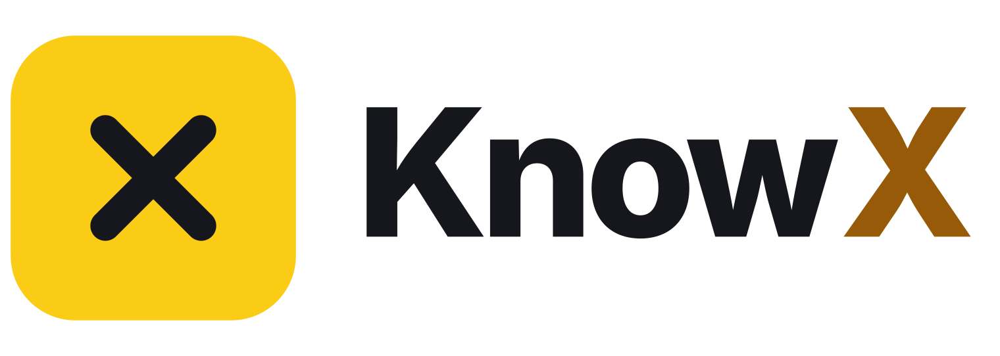
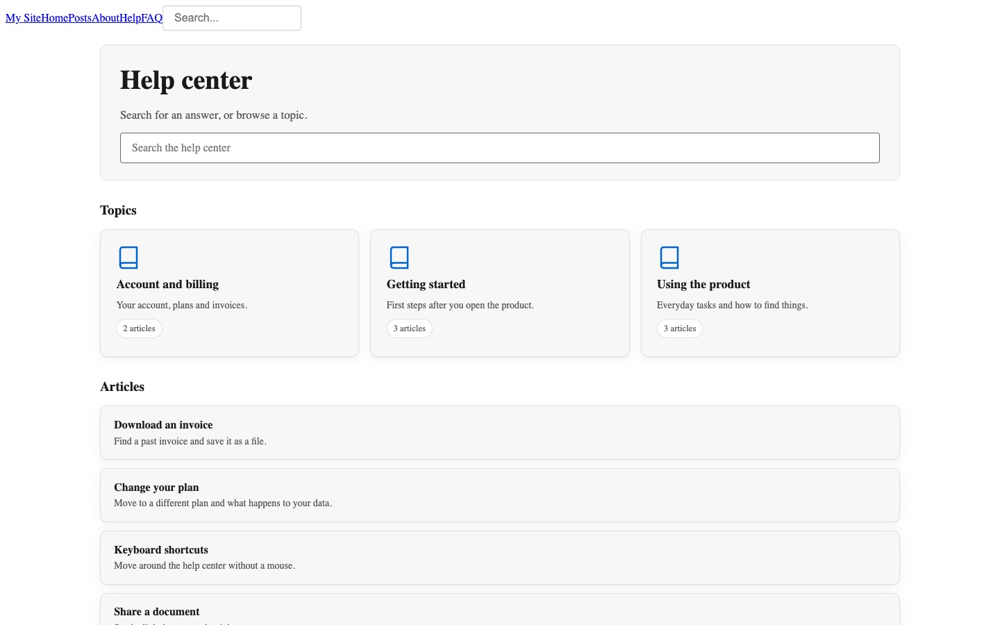
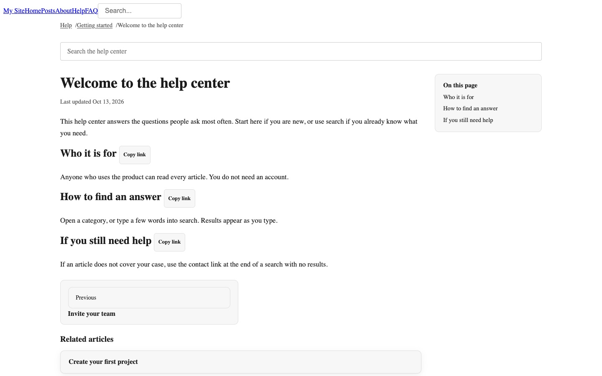
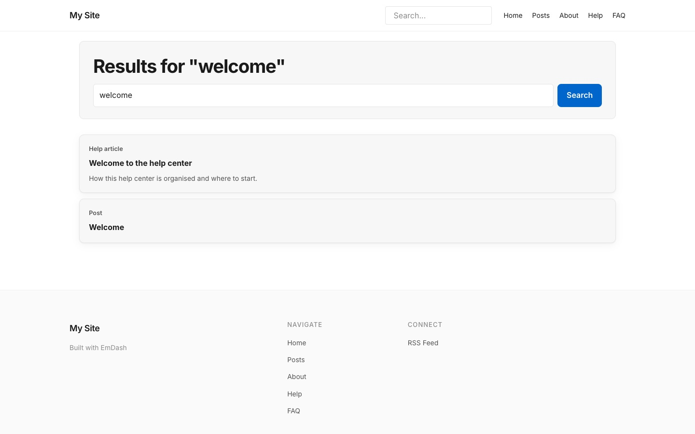
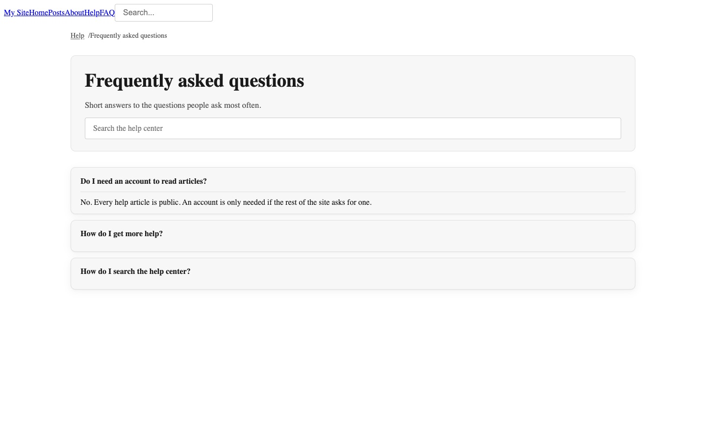
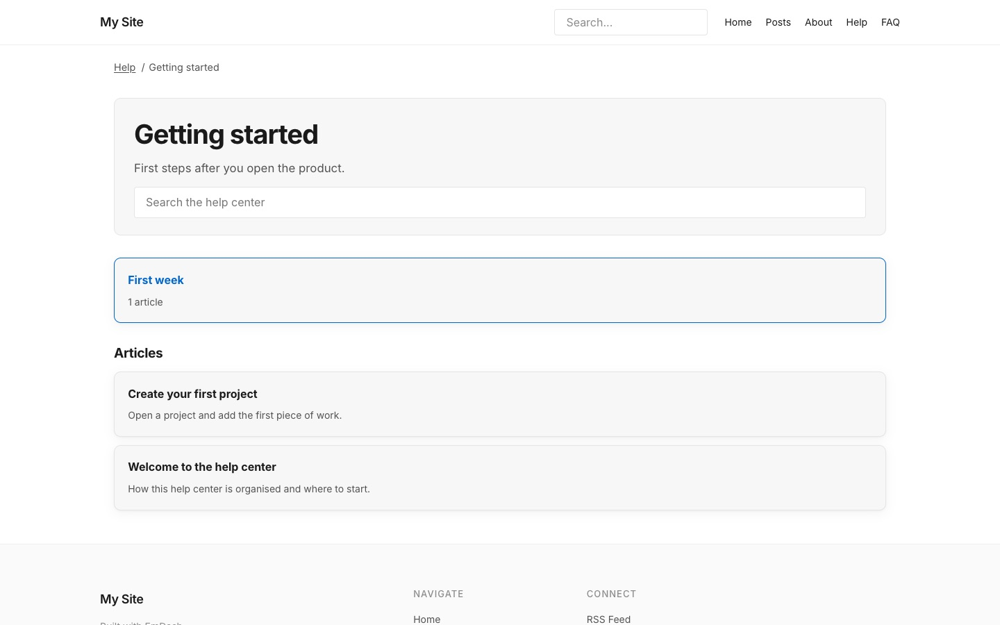

<h3 align="center">A help center for your EmDash site</h3>

Visitors search for an answer, browse topics and say whether an article helped. You see which searches find nothing and which articles need work.

  <a href="https://plugins.emdashcms.com/plugins/@vapvarun.bsky.social/knowx"><b>Install from the EmDash registry</b></a>
  &nbsp;·&nbsp;
  <a href="docs/website/getting-started/introduction.md">Read the docs</a>
  &nbsp;·&nbsp;
  <a href="https://github.com/wbcomdesigns/emdash-knowx/releases">What's new</a>

## Who it is for

A company with a product customers keep asking about, a publisher with several products that each need docs, or anyone who answers the same questions again and again. If you want a searchable help center on your EmDash site, KnowX is for you.

## What you get

**For you, the site owner**

- **Help articles, topics and FAQs** that you write in EmDash's own editor.
- **Insights.** The helpful rate, the least helpful articles by name and readers' comments in plain text.
- **Searches.** Top searches, and the searches that found nothing.
- **A dashboard card** with empty searches this week and the least helpful article.
- **Settings** for feedback, a contact link, what search covers and an icon for each product.

**For your visitors**

- **A help home** with a search box and topic cards.
- **Articles** with a table of contents, copy-link on headings, copy on code, previous and next, and the last updated date.
- **Search as you type**, plus a full results page that says what kind of content each result is.
- **An FAQ page**, written so search engines can show your answers.
- **Was this helpful?** Yes or No on each article, with a short comment after a No.
- **Still need help?** A contact button after an empty search or a No vote, when you set a link.

  
  

## Looks like your site

The help pages take their colours from your EmDash theme and follow light and dark. Change any wording, or the page files themselves. See [Wording and design](docs/website/customize/wording-and-design.md).

  
  

## Get started

1. In your EmDash dashboard, open **Plugins**, then **Registry**, search for **KnowX** and install it. It needs EmDash 1.2 or later and a site that can run registry plugins.
2. Copy the help pages into your site once, as the [install guide](docs/website/getting-started/install.md) shows.
3. Add **Help** and **FAQ** to your menu, write your first articles and open **KnowX**, **Settings**.

## Good to know

- **The help pages are a small kit you copy in.** An EmDash plugin cannot add pages to a site by itself. Until you copy the kit, `/docs/` shows your site's 404 page. Copy it again after every update.
- **Guests can vote when your host passes on the visitor's address.** That works on Cloudflare, or with `trustedProxyHeaders` in your site config. Guests can always search and read. Otherwise they see a sign-in link to vote.
- **Search covers the content types you tick** on Settings. Help articles are on by default.
- **KnowX sends no email.** The contact button is a link you set.
- **Free, with no paid version.**

## Docs

- [Introduction](docs/website/getting-started/introduction.md)
- [Install](docs/website/getting-started/install.md)
- [Your first articles](docs/website/getting-started/first-articles.md)
- [Use cases](docs/website/getting-started/use-cases.md)
- [Settings reference](docs/website/settings/settings-reference.md)
- [Wording and design](docs/website/customize/wording-and-design.md)
- [FAQ](docs/website/faq/faq.md) and [Troubleshooting](docs/website/troubleshooting/troubleshooting.md)

## More from Wbcom Designs for EmDash

[Learnomy](https://github.com/wbcomdesigns/emdash-learnomy) courses · [Listora](https://github.com/wbcomdesigns/emdash-listora) directories · [WB Reviews](https://github.com/wbcomdesigns/emdash-reviews) · [WB Polls](https://github.com/wbcomdesigns/emdash-polls) · [Product Roadmap](https://github.com/wbcomdesigns/emdash-roadmap)

Found a bug or have an idea? [Open an issue](https://github.com/wbcomdesigns/emdash-knowx/issues). Want to build on KnowX? Start with [CONTRIBUTING.md](CONTRIBUTING.md).

MIT licence. Made by [Wbcom Designs](https://wbcomdesigns.com).
