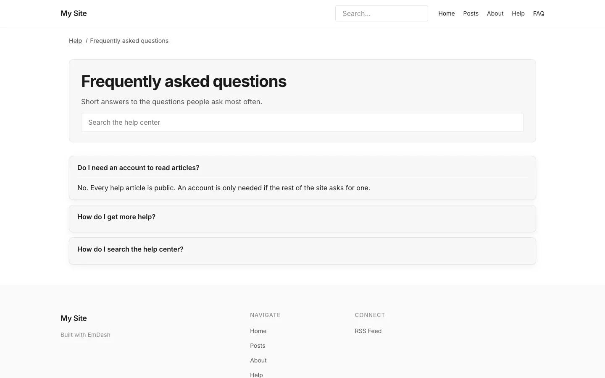

# The FAQ page

**Included in Free.** KnowX has no paid version.

`/docs/faq/` lists every published entry in **FAQs**, sorted by question from A to Z, as a question you can open to read the answer. The first answer is open when the page loads.

To add one, open **FAQs** in admin, choose **Add New**, write the **Question** and **Answer**, and publish. Drafts stay hidden.

The page includes question-and-answer data for search engines, so your FAQs can show directly in search results.

If the FAQs collection does not exist yet, the page says the FAQ is not set up instead of showing an error. See [Install](../getting-started/install.md#step-2-create-the-help-collections).
