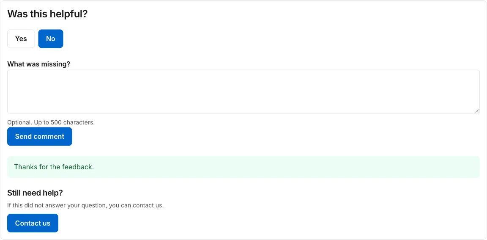

# Was this helpful and Still need help

**Included in Free.** KnowX has no paid version.

## Was this helpful?

Every article ends with **Was this helpful?** and two buttons, **Yes** and **No**.

- Anyone can vote, signed in or not. Each visitor has one vote per article; voting again changes it.
- The button the reader picked stays highlighted, so they can see their vote counted.
- After a **No**, KnowX can ask for a short comment (up to 500 characters). After sending, the box closes and says the comment was sent. Turn the comment box off in **Settings**, **Feedback**.
- Votes are counted per article. Comments show in **Insights** as plain text.

KnowX never stores a visitor's internet address. It keeps a scrambled code made from it, used only to stop repeat votes.

## Still need help?

When you set a contact link in **Settings**, **Still need help**, a contact button appears:

- after a search that finds nothing, and
- after a reader votes **No** on an article.

The link can be a page on your site (`/contact`), a web address, or an email address (`mailto:help@example.com`). Leave it empty to hide the button. KnowX does not send email itself.
