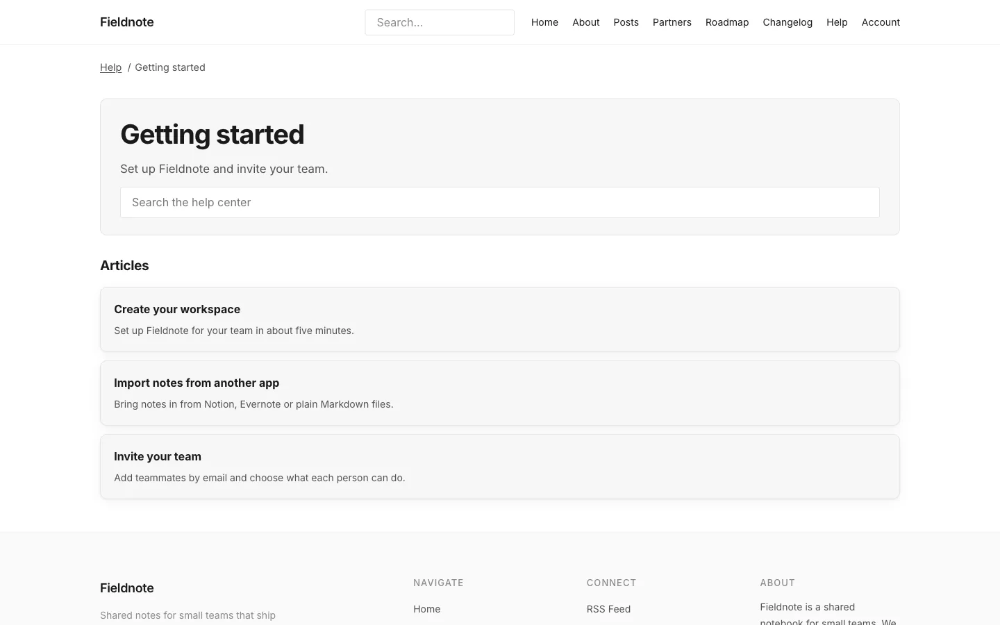
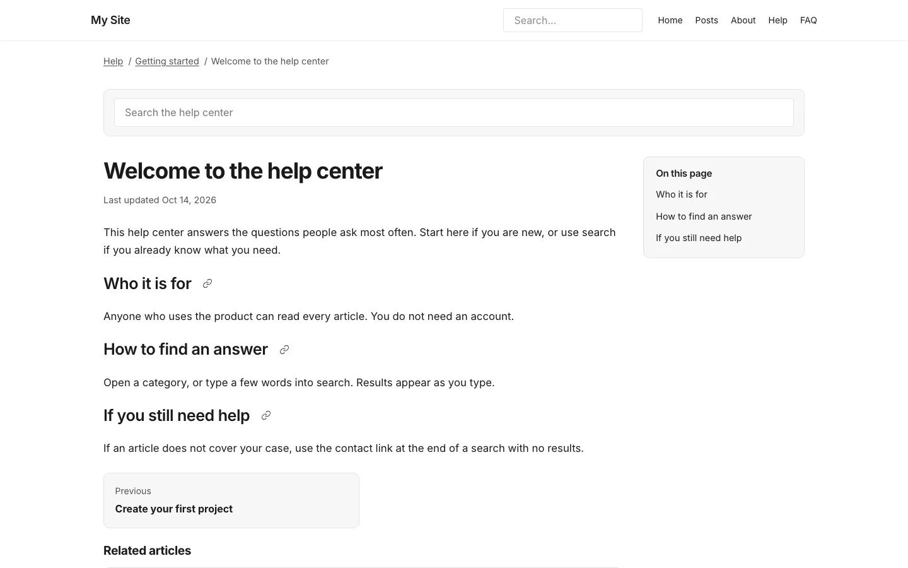

# Help home, topics and articles

**Included in Free.** KnowX has no paid version.

## Help home

`/docs/` opens with a search box, then your topics as cards, then a list of articles.

- With one top-level help category (or none), the cards are your topics.
- With several top-level categories, KnowX treats each as a product: a card with its name, description and the icon you picked in **Settings**, **Product icons**.

## Topic pages

Each topic has its own page at `/docs/category/<topic>/` listing its articles, with a breadcrumb back to the help home. Nested topics work at any depth.

## Article pages

An article at `/docs/<article>/` has:

- A breadcrumb (Help / topic / article).
- The **Applies to version** badge, when filled in.
- **On this page**: the article's headings as a table of contents, on articles with three or more headings.
- A copy-link icon next to each heading, shown on hover or keyboard focus.
- A copy button on every code block.
- The last updated date.
- **Previous** and **Next** within the same topic, and related articles.
- **Was this helpful?** at the end. See [Was this helpful and Still need help](feedback.md).

A missing article shows a short "not found" page with a button back to the help home instead of a bare error.

## Search engines

Articles carry article and breadcrumb data, and the FAQ page carries question-and-answer data, so search engines can show them as rich results.
