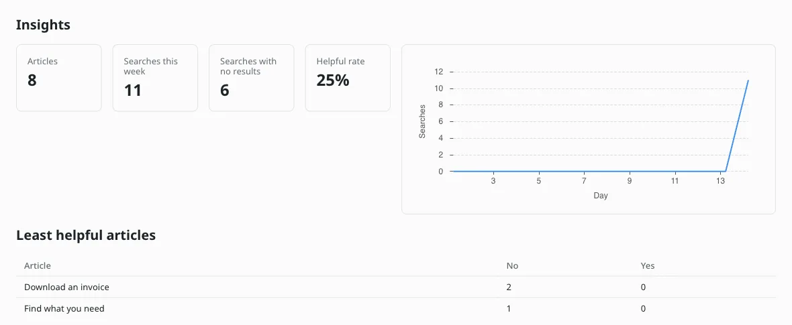

# Insights

**Included in Free.** KnowX has no paid version.

Open **KnowX**, then **Insights** for which articles let readers down, and **Searches** for what people are looking for.

## At the top

- **Articles**: how many published help articles you have (past 100 it shows **100+**)
- **Searches this week**
- **Searches with no results**
- **Helpful rate**: the share of Yes votes across all articles

plus a chart of searches over recent days.

## The lists

| Screen | List | What it tells you | What to do |
| --- | --- | --- | --- |
| Insights | Least helpful articles | Articles with more No than Yes votes, by name | Rewrite them |
| Insights | Recent comments | What readers wrote after a No | Read for the missing detail |
| Searches | Top searches | The words people search most, 25 at a time, with a find box | Make sure each has a good article |
| Searches | Searches with no results | What people wanted and did not find in the last 30 days, with how many times (the 50 most frequent) | Write an article, or add the word to an existing one. A term leaves the list 30 days after its last empty search |

Each list has a short empty state when there is nothing yet. Every vote and every search updates the counts straight away, so both screens open quickly on any size of site.

## After updating from 0.1.x

Votes, comments and search counts from before 0.2.0 are brought over the first few times you open **Insights**. Until that is done Insights shows **Bringing over data from KnowX 0.1** with how many votes are counted so far, and **Continue**. Each step handles about 100 votes, because each request a plugin makes may do only a little work. When it says **Insights is ready**, press **Show Insights**. Nothing is lost while it runs: new votes and searches are counted as usual.

## Dashboard card

The EmDash dashboard shows a KnowX card with empty searches this week and the least helpful article, with links to **Open Insights** and **Open Searches**.
