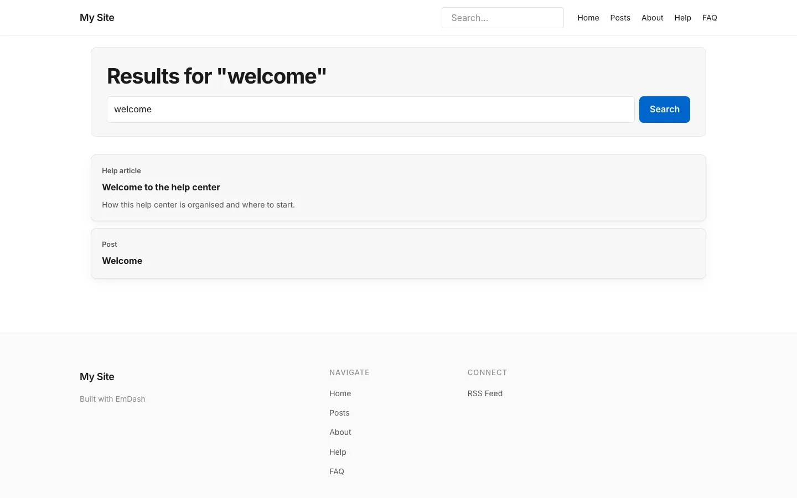

# Search

**Included in Free.** KnowX has no paid version.

KnowX uses EmDash's own site search, limited to the content types you tick in **Settings**, **Search**. Help articles are ticked by default. You can tick up to five types, for example help articles, FAQs and blog posts.

## For visitors

- Type in the search box on any help page. Results appear as you type.
- **Ctrl + K** (Windows) or **Cmd + K** (Mac) jumps to the search box from anywhere on a help page.
- Press Enter for the full results page at `/docs/search`. Each result shows its title, a line from the text and what kind of content it is.

- Search also works with JavaScript turned off, through the results page.

## What gets searched

A content type only returns results if search is turned on for it in **Content Types**. A ticked type with search turned off returns nothing; Settings marks such types so you can fix them.

## The search log

Every search is counted (the words only, never who searched) so **Insights** can show top searches and searches that found nothing. Long searches are shortened in the log.
