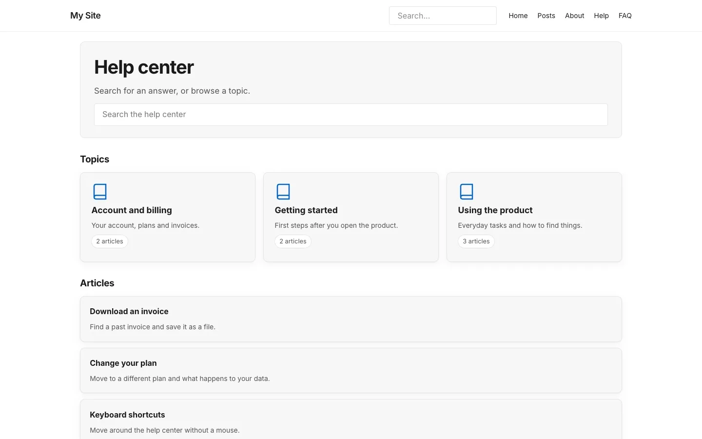

# Introduction

**Included in Free.** KnowX has no paid version.

KnowX turns your EmDash site into a help center. Visitors search for an answer, browse topics and tell you whether an article helped. You see which searches find nothing and which articles need work.

## What visitors get

- **Help home** at `/docs/`: a search box, your topics and a list of articles.
- **Articles** with a table of contents (from three headings up), a copy-link icon on each heading, a copy button on code, previous and next, the last updated date and an optional version badge.
- **Search** as you type, with Ctrl or Cmd + K, and a full results page. Each result says what kind of content it is.
- **FAQ** on its own page, with question-and-answer data search engines understand.
- **Was this helpful?** Yes or No on every article, with an optional short comment after a No.
- **Still need help?** A contact button after an empty search and after a No vote, when you set a contact link.

Everything works for guests. Signing in changes nothing.

## What you get

- **Insights**: searches this week, searches that found nothing, top searches, the least helpful articles and recent comments.
- **A dashboard card** with empty searches this week and the least helpful article.
- **Settings** for feedback, the contact link, what search covers, and an icon for each product.

## How it fits together

| Part | What it does | Where it lives |
| --- | --- | --- |
| The plugin | Votes, the search log, Insights and Settings | Installed from the EmDash registry |
| The site kit | The help pages visitors see | Files your developer copies into the site once |
| Your content | Help articles, FAQs and help categories | EmDash collections you write in, like posts |

Registry plugins cannot add pages to a site by themselves, which is why the pages come as a site kit.

## Next step

[Install KnowX](install.md).
