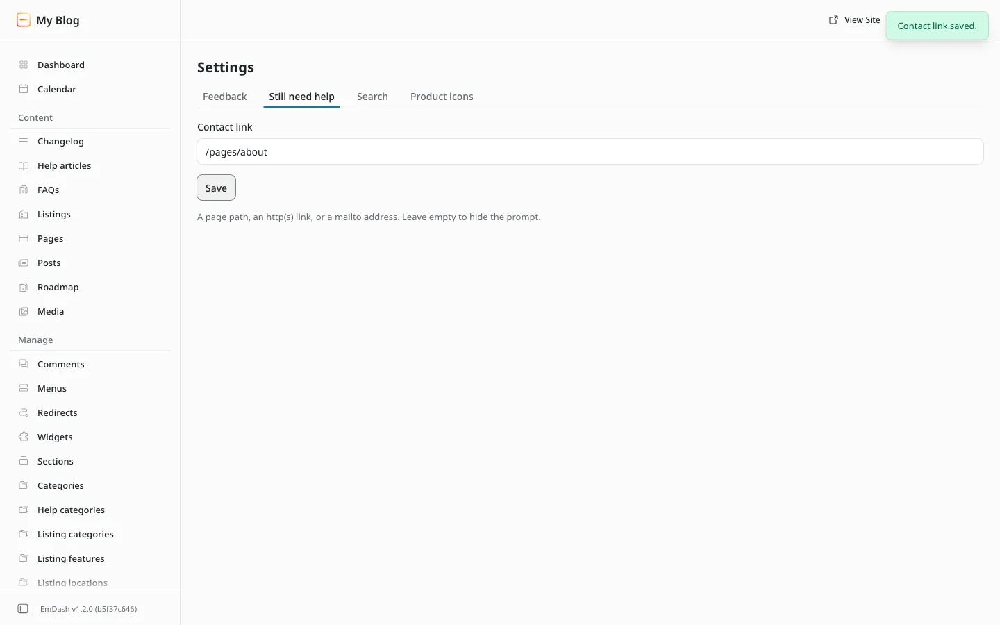

# Settings reference

**Included in Free.** KnowX has no paid version.

Open **KnowX**, then **Settings**. Each tab is one form with its own **Save**.

| Tab | Setting | What it controls | Default |
| --- | --- | --- | --- |
| Feedback | Ask for a comment after a No vote | Shows a short comment box after a reader votes No | On |
| Still need help | Contact link | A page path (`/contact`), a web address, or a `mailto:` address. The contact button shows after an empty search and after a No vote. Leave empty to hide it | Empty |
| Search | Content types | Which content types help search looks through. Tick 1 to 5 | Help articles |
| Product icons | One icon per top-level help category | The icon on each product card on the help home. Only matters when you have more than one top-level category | A default icon |

## Notes

- Search only returns results from a content type that has search turned on in **Content Types**.
- Product icons come from a fixed set (book, rocket, wrench, chat and others), so they always match the help pages' style.
- Settings never change your content. KnowX only reads it.
